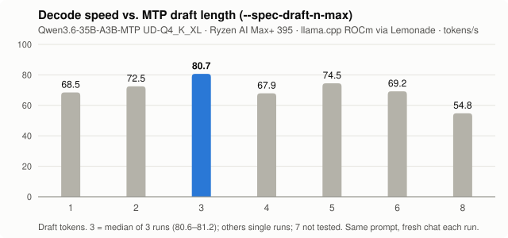

# Local coding agents on Strix Halo (128 GB): what actually works

I've got a mini PC with an AMD Ryzen AI Max+ 395 and 128 GB of unified memory, and wanted to see how close I could get to a capable coding agent that runs entirely at home. I spent about a week throwing models, engines and agent frameworks at it. This page is what survived.

Every number below was measured on this machine unless it says otherwise. Last updated 2026-10-24.

## TL;DR

1. **Small-active MoE + MTP is the sweet spot.** Agent-trained MoE models with about 3–4B active parameters and multi-token prediction beat everything else. Qwen3.6-35B-A3B-MTP runs at **~81 tok/s**, handles tool calls and images, keeps its full 256K context with memory to spare, and fixes a bounded bug in about a minute.

2. **Bandwidth sets the speed, not memory size.** 128 GB lets you *load* a 120B model. 256 GB/s decides whether you'll still be interested by the time it answers.

3. **The NPU is about 5× slower than the iGPU** on the same model, while consuming about a quarter of the electricity per second. It's fine as a small helper and nothing more.

4. **Parallel agents share one memory bus.** Total throughput goes up while each agent slows down. Add long context and every agent drops to 1–4 tok/s.

5. **Local agents are good at narrow tasks, not broad ones.** Single-file fixes passed every test in 50–110 s. Repo-wide reviews either took 4.5–51 minutes and made claims the models later retracted, or, with a 15-minute limit, never finished at all. Raising Qwen3.6 to 256K context finally got the review and self-audit done without compaction. A later MCP-assisted review also finished, but took nearly twice as long and scored the same **6/12**. More context solved one problem. Better code navigation didn't solve the judgment problem.

## The rig

| | |
|---|---|
| Price | 17,500 SEK (~$1,750) for the whole computer |
| Machine | Ryzen AI Max+ 395 · Radeon 8060S iGPU (gfx1151) · XDNA 2 NPU · 128 GB LPDDR5X-8000, 256-bit (**256 GB/s** theoretical) |
| OS | Ubuntu 26.04, kernel 7.0. BIOS VRAM carve-out set to 512 MB; the GPU gets ~116 GiB of shared memory (GTT) with no kernel parameters needed |
| Inference | [Lemonade](https://lemonade-server.ai/) 2026.43 → llama.cpp b11796 (ROCm and Vulkan) · FastFlowLM 1.0.7 on the NPU |
| Agents | OpenCode 2.1, Aider 0.86, Hermes Agent · code navigation via Serena and GitNexus (MCP) |

## Getting started

```bash
# Lemonade server (Ubuntu PPA)
sudo add-apt-repository ppa:lemonade-team/stable && sudo apt install lemonade-server

# Backends: llama.cpp on ROCm for the iGPU, FastFlowLM for the NPU
lemonade backends install llamacpp:rocm
lemonade backends install flm:npu

# Sanity checks: shared GPU memory (should be ~116 GiB) and the NPU device node
cat /sys/class/drm/card*/device/mem_info_gtt_total; ls /dev/accel

# The model and settings that won on this box (saved for future loads)
lemonade pull Qwen3.6-35B-A3B-MTP-GGUF
lemonade load Qwen3.6-35B-A3B-MTP-GGUF --llamacpp rocm --ctx-size 262144 --save-options \
  --llamacpp-args "--parallel 1 --flash-attn on --n-gpu-layers 999 --spec-type draft-mtp --spec-draft-n-max 3 --n-predict 32768"
```

Point your agent at the OpenAI-compatible endpoint `http://localhost:13305/api/v1`. If you'd rather run plain llama.cpp, the same flags work with `llama-server`; add `--jinja`, plus `--mmproj mmproj-F16.gguf` for image input.

## What I found

### 1. MTP: I tuned for an evening and landed on the default



MTP (multi-token prediction) lets the model guess a few tokens ahead and check them all in one pass. On Qwen3.6 it's free speed: **49 → 70 tok/s (+42%)** in a controlled probe (temperature 0, seed 42, 384 tokens), with 59–68% of guesses accepted.

So naturally I tried to get more out of it. I swept `--spec-draft-n-max` from 1 to 8, and **3 won at ~81 tok/s**, steady within 0.6 tok/s over three runs. Going to 8 cost 32%. The value some guides recommend, 6, was 14% slower. And 3 is llama.cpp's default. A whole evening of tuning to confirm the default. I'll call it validation.

**Why 3:** each extra guessed token is less likely to be accepted, and in a MoE model checking it also pulls in more experts, which costs bandwidth. After three, the extra cost outweighs the gain.

I also tried `--spec-draft-p-min`, which makes the model stop guessing once it's unsure. The idea is to waste fewer guesses. With 3 draft tokens, every threshold I tried was slower than the default of 0:

| p-min | 0 (default) | 0.10 | 0.60 | 0.75 | 0.90 |
|---|---:|---:|---:|---:|---:|
| tok/s | **80.7** | 73.2 | 56.8 | 61.9 | 53.4 |

With only three guesses there is little waste to cut, so stopping early mostly throws away tokens that would have been accepted. Score so far: llama.cpp defaults 2, me 0.

Two footnotes:

- **MTP isn't universally good.** On GLM-4.7-Flash it *cut* speed from 70 to 49 tok/s. Test it for each model.
- Allocating 128K context instead of 64K made no difference while the chat was still short (80.7 vs 80.6–81.2 tok/s).

### 2. The lineup

Two speeds per model. *Short prompt* is a quick single request. *Agent median* is the median over every logged request of 100+ tokens in real agent sessions, where the context grows, so expect it to be lower. That median comes from llama.cpp's own timings in Lemonade's system log.

| Model | Quant / size on disk | Short prompt tok/s | Agent median tok/s (requests) | Verdict |
|---|---|---:|---:|---|
| **Qwen3.6-35B-A3B-MTP** | UD-Q4_K_XL, 22 GB | **81** (49 without MTP) | **34** (837) | My daily driver. Tool calls, images, 256K context |
| GLM-4.7-Flash (30B-A3B) | Q4_K_M, ~18 GB | 70 (MTP off) | – ¹ | Fast, and also passes bounded fixes |
| gpt-oss-120b | MXFP4, 59 GB (72 GB in use) | ~48 | 31 (57) | Best of the large models. No MTP, no image input, worthless tool calling |
| Qwen3-Coder-Next (80B-A3B) | Q8_0 | – | 27 (34) | Read thoroughly, then rejected most of its own findings when asked to audit them |
| Gemma-4-31B-it-MTP (dense) | ~19 GB | – | 26 (28) | Used for image tasks, not tested as a coding agent |
| MAI-Code-1.1-Flash | Q2-XS + DFlash drafter, 53 GB | – | 23 (88) | Fits, but no better at finishing broad tasks |
| Qwen3.8-Flash-Next, coder-pruned | IQ1_M, ~85 GB in RAM | 16–22 | 17 (110) | Promising, but its deep review took **51 minutes** |
| DeepSeek-V4-Flash | IQ2_XXS, 81 GB | – | 6 (83) | Test B was still going after an hour, so I stopped it at 62 min |
| Qwen3.8-Flash-Next / GLM-5.3-Flash | UD-Q4_K_XL / UD-Q2_K_XL | – | – | **Didn't even fit in 128 GB** |
| Qwen3.6-35B-A3B **on the NPU** (FastFlowLM) | – | 13–16 | 6 (27) ² | ~5× slower than the iGPU. 30 s before the first token on a 7.6K-token prompt |
| Qwen3.5-4B **on the NPU** | – | – | 43 (20) | Fine as a narrow helper, with 4–6 s to the first token |

¹ GLM ran on a separate test server whose logs weren't kept. ² Partly measured while a GPU job ran at the same time.

**Why the big ones crawl:** generation speed tops out at roughly *bandwidth ÷ bytes read per token*. A dense 27B model at Q4 reads about 17 GB for every token, which caps it at ~15 tok/s. A MoE model with 3B active parameters reads about 2 GB, which allows over 100. Total size only decides whether a model fits. Active parameters decide how fast it runs.

**How fast is 256 GB/s, really?** Quite fast for a computer, slow for a graphics card:

| Computers (system memory) | Bandwidth |
|---|---:|
| Laptop/desktop, DDR4-3200 dual-channel | 51 GB/s |
| Desktop, DDR5-6000 dual-channel | 96 GB/s |
| Desktop, DDR5-8000 dual-channel | 128 GB/s |
| MacBook Pro, M3 Pro | 150 GB/s |
| **This box: Strix Halo, LPDDR5X-8000, 256-bit** | **256 GB/s** |
| NVIDIA DGX Spark (GB10, 128 GB LPDDR5X) | 273 GB/s |
| Mac Studio, M3 Ultra | 819 GB/s |

| Graphics cards (VRAM) | Bandwidth |
|---|---:|
| RTX 4060 (8 GB) | 272 GB/s |
| RTX 3060 (12 GB) | 360 GB/s |
| RTX 4090 (24 GB) | 1,008 GB/s |
| RTX 5090 (32 GB) | 1,792 GB/s |

Strix Halo has 2–5× the bandwidth of an ordinary PC, and roughly matches a budget graphics card, except with 116 GiB usable instead of 8–12 GB. NVIDIA's DGX Spark, the closest rival, is in the same league at 273 GB/s. A flagship card is 7× faster but holds only 32 GB. That's the trade: Strix Halo fits big models, and graphics cards run whatever fits on them fast.

**So who is this box for?** Anyone who would rather run *big* models than *fast* ones. Being able to download a 120B model and just try it, with no cloud account and no juggling layers between GPU and RAM, is genuinely great. And the whole computer cost me 17,500 SEK (~$1,750), about a third of what an RTX 5090 *card alone* costs in Sweden right now (53,000–80,000 SEK new and ~50,000 used, October 2026). The 5090 is ~7× faster, but it holds 32 GB, not 120. The catch is that the big models I tried still weren't good enough to beat the small fast one at real agent work. So for now the main payoff of running them is mostly the feeling that you can. Which, to be fair, is a pretty good feeling.

**Does a dedicated GPU dodge the problem?** Only halfway. If the whole model fits in the card's VRAM, the slow parts drop out: neither system RAM nor the PCIe link is involved while it generates. But once the model spills into system RAM, you're back to the slowest link in the chain, and on a normal PC that is far worse than Strix Halo. Strix Halo has no separate VRAM at all: GPU and CPU share the same 256 GB/s pool, which is how it fits 120B models and also why it can't go faster.

**Engines:** on GLM-4.7-Flash, llama.cpp with a GGUF Q4 quant managed 70 tok/s, against 7.7 for SGLang at BF16 and 6.7 for vLLM at BF16. Part of that gap is the lower precision, but on this box GGUF + llama.cpp is clearly the way to go.

### 3. Subagents: more hands, same narrow bus

I wanted a team of agents working in parallel. The memory bus had other plans.

GLM-4.7-Flash Q8. Each request adds 2,048 new tokens on top of a cached history. Two-stream figures are per stream, averaged over the two streams.

| History | Engine | 1 stream: tok/s · first token | 2 streams: tok/s · first token |
|---|---|---|---|
| 32K | ROCm | 23.9 · 23 s | 9.9 · 88 s |
| 64K | ROCm | 9.3 · 48 s | 4.3 · 197 s |
| 128K | ROCm | 6.1 · 97 s | 2.4 · 377 s |
| 64K | Vulkan | 12.5 · 42 s | 1.5 · 84 s |

- With short prompts, 8 parallel requests reached 166 tok/s *in total*. That's about 21 tok/s per agent, against 70 when one runs alone.
- In a real OpenCode session, two subagents at 39K and 62K context crawled along at **0.9–1.3 tok/s**. Reading one 15K-token prompt took 267 s.
- Even a single agent averaged only 30–35 tok/s in long Qwen sessions, less than half its short-prompt speed.
- Neither backend wins everywhere. ROCm holds up better with two long streams, while Vulkan returns the first token faster.

### 4. But does it get the job done?

| Task | What happened |
|---|---|
| **Bounded bug fix** (a regression reintroduced in one file) | Qwen3.6 + OpenCode: **50–90 s**, 3/3 public + 13/13 held-out tests. Aider: 95 s, pass. GLM-4.7-Flash: 112 s, pass. **This is where local agents shine.** |
| **Broad review, first round** (deep architecture review: trace two UI → backend → UI flows and list weaknesses; OpenCode 1.19, no time limit) | All three finished: gpt-oss-120b in **4.5 min**, Qwen3-Coder-Next 80B Q8 in ~9.5 min, Qwen3.8-Flash-Next IQ1_M in **51 min**. The reports read well but made unsupported claims. When Coder-Next was asked to audit its own report, it marked many of its own findings as unsupported or overstated. |
| **Broad review, controlled re-run** (frozen repo, OpenCode 2.x, 32–64K context, 15 min limit) | **No local run delivered a report on its own.** That includes Qwen3.6, with and without Serena or GitNexus and with serial subagents, plus MAI-Code, GLM-4.7-Flash and DeepSeek. When forced to stop and write up, Qwen scored 5.5/12 and GLM 4/12. On a related source-tracing task, gpt-oss-120b's report scored 0/12. As a comparison, a cloud frontier model (Sol 6.1) did the same review in 6 min and met all 8 rubric points. |
| **Broad review, 256K retest** (Qwen3.6, 32K output limit) | Completed B in **11m54s** (**6/12**), then a critical self-audit in **17m58s** (**8/12**), with no compaction. OpenCode ended at 237,519 context tokens, or 91% of the available window. |
| **Broad review, MCP-assisted rerun** (Qwen3.6, 256K context, explicitly encouraged to use MCP) | Completed in **22m46s** (**6/12**) after a response timeout and retry. Serena was used for symbol navigation and project memory. The report traced the code in more detail but still made unsupported architectural claims and repeated several categories of errors exposed by the earlier self-audit. |
| **General agent** (scheduled Hermes task: web research, then write documents from the findings) | gpt-oss-120b reported success, but its links were stale or broken and it had misused its tools along the way. Qwen3.8-27B passed a small file and spreadsheet test, then spent **76 min and 45 model calls** on the real task without producing a single document, as its context grew from 12K to 119K tokens. Qwen3.6 on the NPU used its tools correctly but managed only ~6 tok/s, and its Swedish was clunky. |

**The A/B/C test: sounding smart is not the same as being right.** I ran three progressively harder prompts against the same Django/React repo: A asked for a quick project summary, B demanded a source-backed architecture review tracing two complete UI → backend → UI flows, and C told the agent to critically audit its own findings and try to disprove them. A was easy: gpt-oss-120b finished in 53 seconds, Qwen3-Coder-Next in 54, and Qwen3.8 IQ1_M in 96. B exposed the differences: 4m31s, 9m23s and a painful 51m26s respectively. The most revealing result came from C: Qwen3-Coder-Next spent another 5m52s checking its own work, then admitted that many of its confidently presented architectural problems were unsupported or overstated. Alleged N+1 queries were already optimized, supposed security flaws were intentional design choices, and recommended refactors risked breaking existing functionality. The models were remarkably good at navigating a large codebase and producing convincing reports. **Actually proving their claims was another matter.**

#### The 256K retest: compaction avoided, judgment still shaky

Raising Qwen3.6's context to 256K and its output limit to 32K finally let it complete both the architecture review and a critical self-audit without a single compaction. Test B took **11m54s** and scored **6/12** on analysis quality. Test C took another **17m58s** and scored **8/12**. By the end, OpenCode reported **237,519 tokens in context (91%)**, with about 24.6K tokens left before the context limit.

The self-audit was genuinely useful. I explicitly asked the model to use the available MCP servers, and it used Serena to trace symbol references rather than relying entirely on text searches. Several recommendations from B were withdrawn or substantially revised.

But the model still confused *no references found* with *safe to delete*, and continued to assign P0 priorities to removing Django models and splitting a large views file. Those conclusions needed more evidence than it had. The 8/12 score reflects a useful self-audit, not permission to apply its recommendations without review.

**So the larger context solved a real workflow problem, but not the judgment problem.** Qwen3.6 could now hold the complete B → C investigation without losing its history. That didn't make every conclusion trustworthy. It just gave the model a better opportunity to check its own work.

#### The MCP rerun: better navigation, same score

I wanted to know whether explicit access to code-intelligence tools would make the initial architecture review more reliable. So I ran B again with one extra instruction: **use MCP servers when suitable**, as it didn't do it on its own in the first run of Task B.

This time Qwen3.6 started with Serena's instructions, tried symbol searches, and loaded persistent project memories. One of those memories, `project_navigation`, already contained a map of the natal-chart execution flow. Some early Serena calls failed, but the model recovered and continued reading actual Python and TypeScript source files.

So the tools were doing something useful. It wasn't just listing directories and guessing what the files contained.

The report was more detailed, too. 

Unfortunately, it still made the kinds of mistakes I was hoping MCP would prevent.

The new report earned **6/12**, exactly the same as the earlier 256K review.

It was also slower: **22m46s versus 11m54s**. That's roughly 91% more wall-clock time, although I wouldn't attribute the difference to MCP alone. This wasn't a clean controlled A/B experiment. The later session loaded existing Serena project memories, its tool path differed, and it encountered a timeout and retry.

I wouldn't call this evidence that the model somehow forgot its own corrections. It's evidence that better navigation, by itself, wasn't enough to stop the same reasoning errors from reappearing.

GitNexus was available in the environment, but the visible tool history confirms Serena use rather than a meaningful GitNexus-assisted analysis.

**My takeaway: MCP improves what the agent can find, not necessarily what it can prove.** Serena helped it navigate symbols and recover project context. The model still had to decide whether a missing reference meant dead code, whether two implementations were accidental duplication, and whether a proposed architectural change was worth the risk. Those decisions were where it stumbled.

In the shorter-context runs, the failure mode was always the same. The context filled up, either with source code or with search results. The agent compressed its history (compaction) and then went back to read material it had already seen. In the coding runs, 17–42% of the lines it read were repeats, and in 32K runs 74–81% of its output went into summarizing its own history. It ran out of time before writing anything up. Symbol-level navigation (Serena) cut the raw reading by 60–80%, but agents still didn't finish. Tool schemas also take up a lot of context: GitNexus alone is 56K characters.

The later 256K runs showed that the compaction loop isn't inevitable. With enough room, Qwen3.6 could finish (though not always in the arbitrary 15 minutes). The harder remaining problem was getting it to distinguish evidence from inference, and finishing efficiently enough for that distinction to be useful.

## What I'd do today

- **Use llama.cpp via Lemonade** with a GGUF Q8 or Q4-class quant, flash attention, `--parallel 1`, and only serial inference.

- **Turn on MTP with 3 draft tokens,** then check per model that it actually helps.

- **Run Qwen3.6 at its full 256K context.** Going from 128K to 256K cost about 3 GB, with ~77 GB still free. Only 10 of its 40 layers use full attention, with 2 KV heads each. The other 30 use linear attention, which keeps a fixed-size state instead of a growing cache. That works out to ~20 KB per token at FP16, so 128K extra tokens cost ~2.7 GB. OpenCode then has ~229K tokens of history before it starts compacting, against ~98K at 128K. In the B → C retest, that was enough to finish both tasks with no compaction at all.

- **Raise the agent's output limit to 32K tokens** (`limit.output` in `opencode.json`, plus `--n-predict 32768` on the server). That's what the model card recommends. OpenCode's default of 4,096 also counts thinking tokens, and with a 1,536-token reasoning budget, compaction summaries were once cut off at around 1,800 tokens and the session crashed.

- **Use Serena for targeted code navigation, not as an automatic truth engine.** Symbol definitions, references and persistent project memories are useful. But a failed symbol search is not proof that code is unused, and an imported constant isn't necessarily a duplicated implementation. Ask for supporting source evidence and counterevidence before accepting architectural recommendations.

- **Keep project memory small and evidence-backed.** A navigation map is useful, but I also want records of verified architectural constraints, active legacy dependencies and previously disproven assumptions. Ideally those records should include source paths and a Git revision, so an agent can check whether the evidence is still current instead of treating old notes as unquestionable truth.

- **Big context is cheap to allocate but slow to fill** (see section 3). Give agents narrow, well-specified jobs, and run subagents one after another instead of in parallel.

- **Watch long thinking phases and request timeouts.** The MCP rerun spent 9m39s in one thinking phase, then hit a response timeout while writing the report. It recovered, but a 22-minute architecture review isn't a great interactive development experience.

- **Watch the temperature.** I saw 98 °C under sustained load, and identical requests ran at speeds up to 2.5× apart.

## Wishlist

- **Hardware: more memory bandwidth.** 128 GB is plenty, but 256 GB/s isn't (relatively speaking). See the bandwidth table above. For the next generation of unified-memory machines, that's the spec to watch.

- **Models: 80–100B total parameters, 3–5B active**, with MTP heads, reliable tool calling, image input and training for long agentic tasks. Ideally they'd also use hybrid linear attention like Qwen3.6, so 256K context stays cheap. At Q8 that's 80–108 GB, leaving room for the context. Since active parameters set the speed, such a model should still run at about 50–80 tok/s. The closest candidates each miss something: gpt-oss-120b has 5.1B active and no MTP or image input (and its tool calling reveals it's an old model), and Qwen3-Coder-Next (80B-A3B) only takes text and is built for coding. Model makers: this hardware is very ready for you.

- **Agent tooling: verified project knowledge, not just more retrieval.** Serena and GitNexus can expose code structure, but I'd like a lightweight system that stores confirmed dependencies, source-backed architectural decisions and known false positives. The agent should be able to ask not only *where is this symbol?* but also *has this conclusion already been checked, and against which revision?* Better tools for finding code are useful. Better tools for knowing when not to refactor it would be even better.

## The fine print

Generation speeds come from llama.cpp server timings and include thinking tokens. Unless noted, each configuration was run once, so treat differences under about 5% as noise. Agent tests used a real Django + React codebase; the controlled runs used a frozen revision and fixed prompts and time limits, while later exploratory runs changed context settings and tool usage.

Raw data is in [`data/`](data/). Regenerate the chart with `python3 scripts/plot_mtp_sweep.py`.

---

*Mikael Folkesson: experimenting with on-device / edge AI agents.*