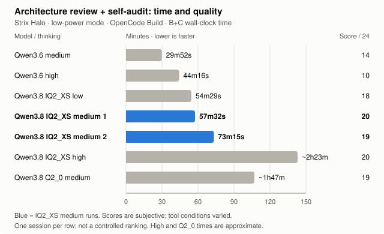

# Local coding agents on Strix Halo (128 GB): what actually works

I've got a mini PC with an AMD Ryzen AI Max+ 395 and 128 GB of unified memory, and wanted to see how close I could get to a capable coding agent that runs entirely at home. I spent about a week throwing models, engines and agent frameworks at it. This page is what survived.

**Update, October 26, 2026:** The first version of this article concluded that large local models weren't worth the extra waiting time for coding-agent work. That was true of the models I'd tried. Then I found a quantization of Qwen3.8 Flash-Next that changed my mind. Apparently, the model I was wishing for already existed. I just hadn't downloaded it.

**Spoiler alert:** Being able to run 181B-models, as opposed to only smaller ones, on your computer does help ;-)

## TL;DR

The review results pair **B**, a source-backed architecture review, with **C**, a critical self-audit in the same session; the combined score is out of 24.

1. **Small-active MoE + multi-token prediction (MTP) is still the speed sweet spot.** Qwen3.6-35B-A3B-MTP runs at **~81 tok/s**, handles tool calls and images, keeps its full 256K context with memory to spare, and fixes a bounded bug in about a minute. It's my fast daily driver.

2. **A bigger model can deliver better judgment.** Qwen3.8 Flash-Next IQ2_XS (a whopping 181B!) at **medium thinking** gave the best balance in my reviews: **20/24 in 57m32s**, then **19/24 in 73m15s** in a second run, versus Qwen3.6 (35B) medium's **14/24 in 29m52s**. Low was surprisingly close (**18/24 in 54m29s**); high took **about 2h23m for 20/24**.

3. **Bandwidth sets the speed, not memory size.** 128 GB lets you *load* a 120B+ model. 256 GB/s decides whether you'll still be interested by the time it answers.

4. **The NPU is about 5× slower than the iGPU** on the same model, while consuming about a quarter of the electricity per second. It's fine as a small helper and nothing more.

5. **Parallel agents share one memory bus.** Total throughput goes up while each agent slows down. Add long context and every agent drops to 1–4 tok/s.

6. **Context solves memory problems; it doesn't guarantee sound conclusions.** Raising Qwen3.6 to 256K let it finish broad reviews without compaction. Serena improved navigation. Neither fixed its tendency to make questionable architectural claims. The larger Qwen3.8 model was noticeably better both at working and checking its own work. *256K context is a minimum for complex tasks to avoid compaction (and risk having to start over again)*.

## The rig

| | |
|---|---|
| Price | 17,500 SEK (~$1,750) for the whole computer |
| Machine | Ryzen AI Max+ 395 · Radeon 8060S iGPU (gfx1151) · XDNA 2 NPU · 128 GB LPDDR5X-8000, 256-bit (**256 GB/s** theoretical) |
| OS | Ubuntu 26.04, kernel 7.0. BIOS VRAM carve-out set to 512 MB; the GPU gets ~116 GiB of shared memory (GTT) with no kernel parameters needed |
| Inference | [Lemonade](https://lemonade-server.ai/) 2026.43 → llama.cpp b11796 (ROCm and Vulkan) · FastFlowLM 1.0.7 on the NPU |
| Agents | OpenCode 2.1, Aider 0.86, Hermes Agent · code navigation via Serena and GitNexus (MCP) |
| The repo | 74 MB source code · 2,863 tracked files in the original test snapshot |

## How I tested

Agent tests used a real Django + React codebase. **A** asked for a quick project summary; **B** demanded a source-backed architecture review tracing two complete UI → backend → UI flows; **C** asked the agent to audit its own review in the same session. The prompts below show B and C; wording varied between runs, including an explicit MCP instruction in the tool-assisted rerun.

<details>
<summary>Test B — architecture review prompt</summary>

```text
Perform a deep architecture analysis of this repository. Do not rely solely on filenames or directory structure.

Read the actual source code of the key backend and frontend modules, trace at least two complete execution flows from UI to backend and back, identify architectural weaknesses and technical debt, and provide concrete recommendations with file paths and line references.

Clearly distinguish verified findings from hypotheses. Do not modify any files.
```

</details>

<details>
<summary>Test C — self-audit prompt</summary>

```text
Critically audit your previous architecture analysis. Your task is to DISPROVE your own findings wherever possible.

Pay particular attention to authentication, CSRF, offline caching, and asynchronous AI tasks.

Do not modify any files.
```

</details>

**How I graded B and C:** Each report received 0–3 points on four criteria, for a maximum of **12**. For B: project understanding, completeness of two execution flows, source verification, and actionable recommendations. For C: following the audit task, evidence and counterevidence, self-correction, and revised recommendations. A zero means missing or fundamentally unsuccessful; three means strongly demonstrated.

These are **my subjective, one-off assessments of the agents' reports and visible logs**, not scores from an independently verified test suite. B+C totals are out of **24**. Serena availability, project memories and tool status varied between sessions, so this is an exploratory comparison rather than a controlled ranking. A one-point difference should not be treated as statistically meaningful.

Everything ran in **Strix Halo low-power mode**, the B+C tests using the **OpenCode Build agent**. **The Plan agent was not tested** and could produce different results. Earlier controlled runs used frozen revisions, fixed prompts and time limits; later exploratory runs varied context settings, runtime flags, tool status and sometimes Git revisions.

## What I found

### 1. The lineup and the bandwidth limit

Two speeds per model. *Short prompt* is a quick single request. *Agent median* is the median over every logged request of 100+ tokens in real agent sessions, where the context grows, so expect it to be lower. That median comes from llama.cpp's own timings in Lemonade's system log.

The Qwen3.8 medians use the October 24–25 journal sample, including exploratory requests and retries as well as scored B+C runs. Generation timings exclude prompt processing and tool time.

| Model | Quant / size on disk | Short prompt tok/s | Generation in agent sessions (tok/s) | Verdict |
|---|---|---:|---:|---|
| **Qwen3.6-35B-A3B-MTP** | UD-Q4_K_XL, 22 GB | **81** (49 without MTP) | **34** median (837 requests) | My fast daily driver. Tool calls, images, 256K context |
| GLM-4.7-Flash (30B-A3B) | Q4_K_M, ~18 GB | 70 (MTP off) | – ¹ | Fast, and also passes bounded fixes |
| gpt-oss-120b | MXFP4, 59 GB (72 GB in use) | ~48 | 31 median (57) | Fast for its size, disappointing coding-agent tool calling |
| Qwen3-Coder-Next (80B-A3B) | Q8_0 | – | 27 median (34) | Read thoroughly, then rejected most of its own findings when asked to audit them |
| **Qwen3.8-Flash-Next GSQ-RCO (181B-A6B)** | **IQ2_XS, ~68 GB + MTP head + Vision head** | – | **15.5** journal median (385 responses) | **Best deep architecture-review result** |
| **Qwen3.8-Flash-Next GSQ-RCO** | **Q2_0, ~66 GB + MTP head** | – | **10.6** journal median (200 responses) | Nearly as good, much slower in my agent runs |
| Gemma-4-31B-it-MTP (dense) | ~19 GB | – | 26 median (28) | Used for image tasks, not tested as a coding agent |
| MAI-Code-1.1-Flash | Q2-XS + DFlash drafter, 53 GB | – | 23 median (88) | Fits, but no better at finishing broad tasks |
| Qwen3.8-Flash-Next, coder-pruned | IQ1_M, ~85 GB in RAM | 16–22 | 17 median (110) | Promising, but its deep review took **51 minutes** |
| DeepSeek-V4-Flash | IQ2_XXS, 81 GB | – | 6 median (83) | Test B was still going after an hour, so I stopped it at 62 min |
| Larger Qwen3.8 / GLM-5.3 variants | UD-Q4_K_XL / UD-Q2_K_XL | – | – | **These quantizations didn't fit in 128 GB** |
| Qwen3.6-35B-A3B **on the NPU** (FastFlowLM) | – | 13–16 | 6 median (27) ² | ~5× slower than the iGPU. 30 s before the first token on a 7.6K-token prompt |
| Qwen3.5-4B **on the NPU** | – | – | 43 median (20) | Fine as a narrow helper, with 4–6 s to the first token |

¹ GLM ran on a separate test server whose logs weren't kept. ² Partly measured while a GPU job ran at the same time.

Qwen3.8 has about **125B parameters in the main MoE, with roughly 6B active per token**, plus a **51.2B N-gram component**. The IQ2_XS setup's **~181B combined budget** also counts the separate MTP head and vision projector.

**Why the big ones crawl:** generation speed depends heavily on *bytes read per token*. A dense 27B model at Q4 reads roughly 17 GB of weights for every token, which gives a theoretical bandwidth ceiling around 15 tok/s. A MoE model with 3B active parameters reads much less. Actual performance also depends on attention, caching, quantization kernels and the model's architecture.

**How fast is 256 GB/s, really?** Quite fast for a computer, slow for a graphics card:

| Computers (system memory) | Bandwidth |
|---|---:|
| Laptop/desktop, DDR4-3200 dual-channel | 51 GB/s |
| Desktop, DDR5-6000 dual-channel | 96 GB/s |
| Desktop, DDR5-8000 dual-channel | 128 GB/s |
| MacBook Pro, M3 Pro | 150 GB/s |
| **This box: Strix Halo, LPDDR5X-8000, 256-bit** | **256 GB/s** |
| NVIDIA DGX Spark (GB10, 128 GB LPDDR5X) | 273 GB/s |
| Mac Studio, M3 Ultra | 819 GB/s |

| Graphics cards (VRAM) | Bandwidth |
|---|---:|
| RTX 4060 (8 GB) | 272 GB/s |
| RTX 3060 (12 GB) | 360 GB/s |
| RTX 4090 (24 GB) | 1,008 GB/s |
| RTX 5090 (32 GB) | 1,792 GB/s |

Strix Halo has 2–5× the bandwidth of an ordinary PC, and roughly matches a budget graphics card, except with 116 GiB usable instead of 8–12 GB. NVIDIA's DGX Spark, the closest rival, is in the same league at 273 GB/s. A flagship card is 7× faster but holds only 32 GB. That's the trade: Strix Halo fits big models, and graphics cards run whatever fits on them fast.

**So who is this box for?** Anyone who would rather run *big* models than *fast* ones. Being able to download a 120B+ model and just try it, with no cloud account and no juggling layers between GPU and RAM, is genuinely great. And the whole computer cost me 17,500 SEK (~$1,750), about a third of what an RTX 5090 *card alone* costs in Sweden right now (53,000–80,000 SEK new and ~50,000 used, October 2026).

**Does a dedicated GPU dodge the problem?** Only halfway. If the whole model fits in the card's VRAM, the slow parts drop out: neither system RAM nor the PCIe link is involved while it generates. But once the model spills into system RAM, you're back to the slowest link in the chain, and on a normal PC that is far worse than Strix Halo. Strix Halo has no separate VRAM at all: GPU and CPU share the same 256 GB/s pool, which is how it fits very large models and also why it can't go faster.

**Engines:** on GLM-4.7-Flash, llama.cpp with a GGUF Q4 quant managed 70 tok/s, against 7.7 for SGLang at BF16 and 6.7 for vLLM at BF16. Part of that gap is the lower precision, but on this box GGUF + llama.cpp is clearly the way to go.

### 2. MTP: I tuned for an evening and landed on the default

MTP (multi-token prediction) lets the model guess a few tokens ahead and check them all in one pass. On Qwen3.6 it's free speed: **49 → 70 tok/s (+42%)** in a controlled probe (temperature 0, seed 42, 384 tokens), with 59–68% of guesses accepted.


So naturally I tried to get more out of it. I swept `--spec-draft-n-max` from 1 to 8, and **3 won at ~81 tok/s**, steady within 0.6 tok/s over three runs. Going to 8 cost 32%. The value some guides recommend, 6, was 14% slower. And 3 is llama.cpp's default. A whole evening of tuning to confirm the default. I'll call it validation.

**Why 3:** each extra guessed token is less likely to be accepted, and in a MoE model checking it also pulls in more experts, which costs bandwidth. After three, the extra cost outweighs the gain.

I also tried `--spec-draft-p-min`, which makes the model stop guessing once it's unsure. The idea is to waste fewer guesses. With 3 draft tokens, every threshold I tried was slower than the default of 0:

| p-min | 0 (default) | 0.10 | 0.60 | 0.75 | 0.90 |
|---|---:|---:|---:|---:|---:|
| tok/s | **80.7** | 73.2 | 56.8 | 61.9 | 53.4 |

With only three guesses there is little waste to cut, so stopping early mostly throws away tokens that would have been accepted. Score so far: llama.cpp defaults 2, me 0.

Two footnotes:

- **MTP isn't universally good.** On GLM-4.7-Flash it *cut* speed from 70 to 49 tok/s. Test it for each model.
- Allocating 128K context instead of 64K made no difference while the chat was still short (80.7 vs 80.6–81.2 tok/s).

### 3. Subagents: more hands, same narrow bus

I wanted a team of agents working in parallel. The memory bus had other plans.

GLM-4.7-Flash Q8. Each request adds 2,048 new tokens on top of a cached history. Two-stream figures are per stream, averaged over the two streams.

| History | Engine | 1 stream: tok/s · first token | 2 streams: tok/s · first token |
|---|---|---|---|
| 32K | ROCm | 23.9 · 23 s | 9.9 · 88 s |
| 64K | ROCm | 9.3 · 48 s | 4.3 · 197 s |
| 128K | ROCm | 6.1 · 97 s | 2.4 · 377 s |
| 64K | Vulkan | 12.5 · 42 s | 1.5 · 84 s |

- With short prompts, 8 parallel requests reached 166 tok/s *in total*. That's about 21 tok/s per agent, against 70 when one runs alone.
- In a real OpenCode session, two subagents at 39K and 62K context crawled along at **0.9–1.3 tok/s**. Reading one 15K-token prompt took 267 s.
- Even a single agent averaged only 30–35 tok/s in long Qwen sessions, less than half its short-prompt speed.
- Neither backend wins everywhere. ROCm holds up better with two long streams, while Vulkan returns the first token faster.

### 4. But does it get the job done?

Generation speed is only half the story. I tested bounded fixes, broad code reviews and a more general agent task.

| Task | What happened |
|---|---|
| **Bounded bug fix** (a regression reintroduced in one file) | Qwen3.6 + OpenCode: **50–90 s**, 3/3 public + 13/13 held-out tests. Aider: 95 s, pass. GLM-4.7-Flash: 112 s, pass. **This is where fast local agents shine.** |
| **General agent** (scheduled Hermes task: web research, then write documents from the findings) | gpt-oss-120b reported success, but its links were stale or broken and it had misused its tools along the way. Qwen3.8-27B passed a small file and spreadsheet test, then spent **76 min and 45 model calls** on the real task without producing a single document, as its context grew from 12K to 119K tokens. Qwen3.6 on the NPU used its tools correctly but managed only ~6 tok/s, and its Swedish was clunky. |

#### The early reviews: convincing reports, weak evidence

| Review round | What happened |
|---|---|
| **Broad review, first round** (deep architecture review: trace two UI → backend → UI flows and list weaknesses; OpenCode 1.19, no time limit) | All three finished: gpt-oss-120b in **4.5 min**, Qwen3-Coder-Next 80B Q8 in ~9.5 min, Qwen3.8-Flash-Next IQ1_M in **51 min**. The reports read well but made unsupported claims. When Coder-Next was asked to audit its own report, it marked many of its findings as unsupported or overstated. |
| **Broad review, controlled re-run** (frozen repo, OpenCode 2.x, 32–64K context, 15 min limit) | **No local run delivered a report on its own.** That includes Qwen3.6, with and without Serena or GitNexus and with serial subagents, plus MAI-Code, GLM-4.7-Flash and DeepSeek. When forced to stop and write up, Qwen scored 5.5/12 and GLM 4/12. On a related source-tracing task, gpt-oss-120b's report scored 0/12. As a comparison, a cloud frontier model (Sol 6.1) did the same review in 6 min and met all 8 rubric points. |

The first round made A ("Quick summary of this project please") look easy: gpt-oss-120b finished in 53 seconds, Qwen3-Coder-Next in 54, and Qwen3.8 IQ1_M in 96. B exposed the differences: 4m31s, 9m23s and a painful 51m26s respectively. The most revealing result came from C: Qwen3-Coder-Next spent another 5m52s checking its own work, then admitted that many of its confidently presented architectural problems were unsupported or overstated. Alleged N+1 queries were already optimized, supposed security flaws were intentional design choices, and recommended refactors risked breaking existing functionality. The models were remarkably good at navigating a large codebase and producing convincing reports. **Actually proving their claims was another matter.**

In the shorter-context runs (32-64K), the failure mode was often the same. The context filled up, either with source code or with search results. The agent compressed its history (compaction) and then went back to read material it had already seen. In the coding runs, 17–42% of the lines it read were repeats, and in 32K runs 74–81% of its output went into summarizing its own history. It ran out of time before writing anything up. Symbol-level navigation (Serena) cut the raw reading by 60–80%, but agents still didn't finish. Tool schemas also take up a lot of context: GitNexus alone is 56K characters.

#### The 256K retest: compaction avoided, judgment still shaky

Raising Qwen3.6's context to 256K and its output limit to 32K finally let it finish B+C without compaction: **29m52s and 14/24** at medium thinking. By the end, OpenCode reported **237,519 tokens in context (91%)**, with about 24.6K tokens left.

The self-audit was genuinely useful. I explicitly asked the model to use the available MCP servers (Serena, GitNexus), and it used Serena to trace symbol references rather than relying entirely on text searches. Several recommendations from B were withdrawn or substantially revised.

But the model still confused *no references found* with *safe to delete*, and continued to assign P0 priorities to removing Django models and splitting a large views file. Those conclusions needed more evidence than it had. The 8/12 score reflects a useful self-audit, not permission to apply its recommendations without review.

**So the larger context solved a real workflow problem, but not the judgment problem.** Qwen3.6 could now hold the complete B → C investigation without losing its history. That didn't make every conclusion trustworthy. It just gave the model a better opportunity to check its own work.

#### The MCP rerun: better navigation, same score

I wanted to know whether explicit access to code-intelligence tools would make the initial architecture review more reliable. So I ran B again with one extra instruction: **use MCP servers when suitable**, as it didn't do it on its own in the first run of Task B.

This time Qwen3.6 started with Serena's instructions, tried symbol searches, and loaded persistent project memories. One of those memories, `project_navigation`, already contained a map of an execution flow. Some early Serena calls failed, but the model recovered and continued reading actual Python and TypeScript source files.

Unfortunately, the report still made the kinds of mistakes I was hoping MCP would prevent. It earned **6/12**, exactly the same as the earlier 256K review.

It was also slower: **22m46s versus 11m54s**. That's roughly 91% more wall-clock time, although I wouldn't attribute the difference to MCP alone. This wasn't a clean controlled A/B experiment. The later session loaded existing Serena project memories, its tool path differed, and it encountered a timeout and retry.

GitNexus was available in the environment, but the visible tool history confirms Serena use rather than a meaningful GitNexus-assisted analysis.

**My takeaway: MCP improves what the agent can find, not necessarily what it can prove or how well it thinks.** Serena helped it navigate symbols and recover project context. The model still had to decide whether a missing reference meant dead code, whether two implementations were accidental duplication, and whether a proposed architectural change was worth the risk. Those decisions were where it stumbled.

#### The bigger model: an actual improvement

Then I tested **Qwen3.8 Flash-Next GSQ-RCO IQ2_XS**, and finally got a different result.

It isn't very fast, but also not unusably slow. The journal sample gives a **15.5 tok/s median for generation alone**. Its first medium B+C run scored **20/24 in 57m32s**.

The improvement wasn't just more detail. It rechecked stale project memory against the current Git revision, traced the actual frontend/backend flows, and was more careful about distinguishing problems from deliberate compatibility decisions. In Test C it corrected source references, qualified security claims, and reconsidered recommendations that could break working code.

That is what I had been missing. Qwen3.6 was quite good at finding code. Qwen3.8 was better at deciding what the findings *meant*.

I also tested the same model in **Q2_0**, a slightly smaller, simpler quantization. It performed nearly as well: **9/12 for B and 10/12 for C**. Its self-audit caught substantial mistakes in its own report. But B+C took approximately **107 minutes**, versus **58 minutes** for the first IQ2_XS medium run.

Interestingly, Q2_0 is faster in the quantization publisher's inference benchmarks. Not so on my agent tasks. The difference may involve quantization kernels, runtime configuration, or simply the model's decisions about how long to investigate. One run per configuration can't tell us which.

A later IQ2_XS run with explicit llama.cpp settings, including `--lazy-mode off`, completed B in **26m15s (9/12)** and B+C in **73m15s (19/24)**. The original **10/12** run had used only `--spec-type draft-mtp --parallel 1` as explicit llama.cpp arguments. Both used medium thinking. The newer B was faster, but the full B+C session was slower and analyzed a different repository revision, so I'm not calling that a controlled tuning result.

#### Thinking level: the extra time has to earn its keep

With both models able to finish, I compared the completed B+C sessions. These are individual runs under the varying conditions described above.

| Model / thinking | B | C | B+C total | Score |
|---|---:|---:|---:|---:|
| Qwen3.6 medium | 11m54s (6/12) | 17m58s (8/12) | **29m52s** | **14/24** |
| Qwen3.6 high | 15m16s | 29m00s | **44m16s** | **10/24** |
| Qwen3.8 IQ2_XS low | 24m43s | 29m46s | **54m29s** | **18/24** |
| Qwen3.8 IQ2_XS medium, first | 33m47s (10/12) | 23m45s (10/12) | **57m32s** | **20/24** |
| Qwen3.8 IQ2_XS medium, second | 26m15s (9/12) | — | **73m15s** | **19/24** |
| Qwen3.8 IQ2_XS high | — | — | **~2h23m** | **20/24** |
| Qwen3.8 Q2_0 medium | ~64m (9/12) | 43m23s (10/12) | **~1h47m** | **19/24** |



*Qwen3.8 uses IQ2_XS except where marked Q2_0. High and Q2_0 times are approximate. Low-power mode, OpenCode Build; subjective scores and varying tool status, not a controlled ranking.*

**The revised conclusion:** Qwen3.8 IQ2_XS **medium offers the best balance** here. Low came surprisingly close at **54m29s and 18/24**; high took **about 2h23m for 20/24**, with no clear gain over medium. Qwen3.6 high also failed to improve on medium: **44m16s and 10/24**, versus **29m52s and 14/24**. These runs suggest that more thinking is no guarantee of better judgment.

## What I'd do today

- **Use Qwen3.6-35B-A3B-MTP as the fast daily driver.** llama.cpp via Lemonade, ROCm, 256K context, and MTP with 3 draft tokens. It is much more pleasant for interactive work.

- **Use Qwen3.8 Flash-Next IQ2_XS at medium thinking for deep reviews.** Run B and C in the same session. Low is a promising alternative; high cost much more time without a clear quality gain.

- **Don't assume more manual inference flags are better.** The best-scoring IQ2_XS run used mostly defaults. Another configuration finished B faster but took longer for B+C, without a higher score. Record what was actually passed to `llama-server` before comparing runs.

- **Raise the agent's output limit to 32K tokens** (`limit.output` in `opencode.json`, plus `--n-predict 32768` on the server if needed). OpenCode's default of 4,096 also counts thinking tokens, and with a 1,536-token reasoning budget, compaction summaries were once cut off at around 1,800 tokens and the session crashed.

- **Use Serena for targeted code navigation, not as an automatic truth engine.** Symbol definitions, references and persistent project memories are useful. But a failed symbol search is not proof that code is unused, and an imported constant isn't necessarily a duplicated implementation. Ask for supporting source evidence and counterevidence before accepting architectural recommendations.

- **Big context is cheap to allocate but slow to fill** (see the subagent results above). Give agents narrow, well-specified jobs, and run subagents one after another instead of in parallel.

## Getting started

To reproduce the fast daily-driver setup above:

```bash
# Lemonade server (Ubuntu PPA)
sudo add-apt-repository ppa:lemonade-team/stable && sudo apt install lemonade-server

# Backends: llama.cpp on ROCm for the iGPU, FastFlowLM for the NPU
lemonade backends install llamacpp:rocm
lemonade backends install flm:npu

# Sanity checks: shared GPU memory (should be ~116 GiB) and the NPU device node
cat /sys/class/drm/card*/device/mem_info_gtt_total; ls /dev/accel

# My fast daily-driver configuration
lemonade pull Qwen3.6-35B-A3B-MTP-GGUF

# My deep-review model: Qwen3.8 IQ2_XS with separate MTP and vision components
lemonade pull user.Qwen38-IQ2XS-MTP \
  --checkpoint main ISTA-DASLab/Qwen3.8-Flash-Next-GSQ-RCO-GGUF:IQ2_XS \
  --checkpoint draft ggml-org/Qwen3.8-Flash-Next-GGUF:mtp-Qwen3.8-Flash-Next-Q8_0.gguf \
  --checkpoint mmproj ISTA-DASLab/Qwen3.8-Flash-Next-GSQ-RCO-GGUF:mmproj-Qwen3.8-Flash-Next-BF16.gguf \
  --recipe llamacpp \
  --label mtp \
  --label vision \
  --label reasoning \
  --label tool-calling

# Load the fast daily driver
lemonade load Qwen3.6-35B-A3B-MTP-GGUF --llamacpp rocm --ctx-size 262144 --save-options \
  --llamacpp-args "--parallel 1 --flash-attn on --n-gpu-layers 999 --spec-type draft-mtp --spec-draft-n-max 3 --n-predict 32768"
```

Point your agent at the OpenAI-compatible endpoint `http://localhost:13305/api/v1`. If you'd rather run plain llama.cpp, the same flags work with `llama-server`; add `--jinja`, plus `--mmproj mmproj-F16.gguf` for image input.

## Wishlist

- **Hardware: more memory bandwidth.** 128 GB is plenty, but 256 GB/s isn't (relatively speaking). See the bandwidth table above. For the next generation of unified-memory machines, that's the spec to watch. That's basically it.

- **Models: smart composition.** New ways to increase speed, focus on the right things, and be as reliable as the top cloud models.


## Next

- **Next tests: Plan and power mode.** These B+C runs used OpenCode Build in low-power mode. Plan and a higher power setting remain untested; either could change the result. Though probably not enough to feel it's worth testing. Or?

## The fine print

Generation speeds include thinking tokens. Journal medians measure generation alone; OpenCode workflow rates and B+C wall-clock times include different overheads and should not be compared directly. Unless noted, each configuration was run once.

The B/C rubric is a subjective reading of reports and visible logs, not an independent correctness test. In particular, a one-point difference between IQ2_XS and Q2_0 cannot establish which quantization retains more model capability. The larger model's stronger reviews are encouraging; the precise ranking needs repeated, controlled runs.

Raw data is in [`data/`](data/). Regenerate the MTP chart with `python3 scripts/plot_mtp_sweep.py`.

---

*Experimenting with on-device / edge AI agents.*